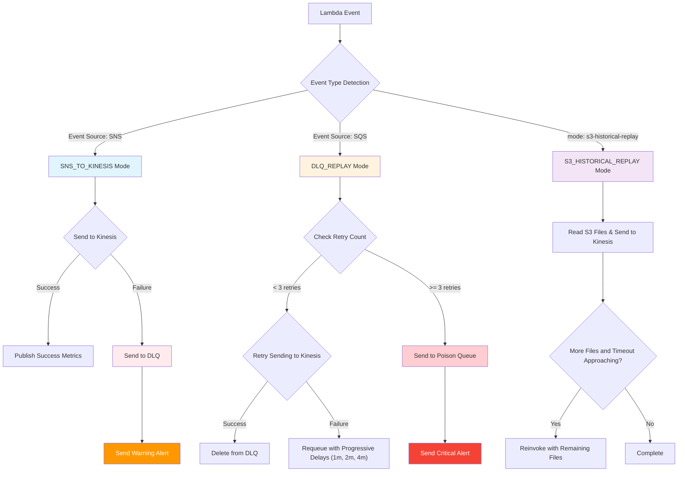

# ShiftOpportunity Unified Processor

## Overview

The ShiftOpportunity Unified Processor is a sophisticated Lambda-based system that handles real-time streaming data processing with comprehensive error handling and historical data replay capabilities. It serves as the central processing hub for the ShiftOpportunity service events, routing data from SNS to Kinesis while providing robust error recovery mechanisms.

## Architecture



## System Components

### Core Modules

1. **`lambda_function.py`** - Main Lambda handler that routes events to appropriate processors
2. **`config.py`** - Configuration management and processing mode detection
3. **`aws_clients.py`** - Centralized AWS service interactions (Kinesis, SQS, SNS, S3, CloudWatch)
4. **`sns_processor.py`** - Real-time SNS to Kinesis processing
5. **`dlq_processor.py`** - Event-driven DLQ replay with retry logic
6. **`s3_processor.py`** - Historical data replay from S3

### Processing Modes

The system automatically detects and routes to the appropriate processing mode based on the incoming Lambda event structure:

#### 1. SNS to Kinesis Mode (`SNS_TO_KINESIS`)
- **Trigger**: SNS notifications (direct or via Lambda Records)
- **Purpose**: Real-time processing of shift opportunity events
- **Flow**: SNS → Validation → Envelope Creation → Kinesis
- **Error Handling**: Failed records sent to Unified DLQ
- **Event Detection**: 
  - Direct SNS: `Type: "Notification"` and `TopicArn` present
  - Lambda SNS: `Records` array with `eventSource: "aws:sns"`

#### 2. DLQ Replay Mode (`DLQ_REPLAY`)
- **Trigger**: SQS Event Source Mapping from Unified DLQ
- **Purpose**: Automatic retry of failed messages
- **Flow**: DLQ → Validation → Retry Logic → Kinesis or Poison Queue
- **Error Handling**: Max 3 retries with exponential backoff (1m, 2m, 4m)
- **Event Detection**: `Records` array with `eventSource: "aws:sqs"`

#### 3. S3 Historical Replay Mode (`S3_HISTORICAL_REPLAY`)
- **Trigger**: Manual invocation with replay parameters
- **Purpose**: Batch processing of historical data from S3
- **Flow**: S3 → Download → Parse → Batch Processing → Target Lambda
- **Error Handling**: Continuation handling and timeout management
- **Event Detection**: `mode: "s3-historical-replay"` in event

## Error Handling Strategy

The system implements a unified, comprehensive error handling strategy:

### Error Flow Hierarchy

1. **Immediate Retry**: Built-in retry for transient failures
2. **Unified DLQ**: Single centralized queue for all error types
3. **Event-Driven Processing**: Automatic DLQ processing via SQS Event Source Mapping
4. **Exponential Backoff**: Progressive retry delays (60s, 120s, 240s)
5. **Poison Queue**: Final destination for permanently failed messages (14-day retention)
6. **Real-time Alerts**: SNS notifications at every error stage

### Error Categories

- **SNS Parsing Errors**: Malformed or invalid SNS messages
- **Kinesis Write Failures**: Transient or persistent write issues
- **Validation Errors**: Data that doesn't meet required schema
- **Processing Timeouts**: Operations that exceed time limits
- **AWS Service Errors**: Connectivity or permission issues

## Configuration

### Environment Variables

#### Core Configuration
```bash
LAMBDA_REGION=us-east-1
KINESIS_STREAM_NAME=ShiftOpportunityServiceEvents
ENVIRONMENT=hda-gamma
```

#### Queue Configuration
```bash
UNIFIED_DLQ_URL=<SQS_URL>
POISON_QUEUE_URL=<SQS_URL>
ALERT_SNS_TOPIC_ARN=<SNS_ARN>
```

#### Processing Settings
```bash
MAX_RETRY_ATTEMPTS=3
DLQ_BATCH_SIZE=10
ERROR_RATE_THRESHOLD=5.0
MAX_MESSAGE_SIZE_KB=256
```

#### S3 Replay Configuration
```bash
S3_BUCKET=shift-opportunity-service-events
S3_RAW_PREFIX=raw/
TARGET_LAMBDA_FUNCTION=ShiftOpportunityServiceEvents-sns-to-kinesis
BATCH_SIZE=25
MIN_TIME_FOR_FILE_MS=30000
```

## Monitoring and Alerting

### CloudWatch Metrics

The system publishes comprehensive metrics to the `ShiftOpportunity/UnifiedProcessor` namespace:

#### Processing Metrics
- `SNSRecordsReceived`: Count of incoming SNS records
- `SNSSuccessfulRecords`: Successfully processed records
- `SNSFailedRecords`: Failed record count
- `SNSSuccessRate`: Percentage of successful processing
- `SNSProcessingTime`: Processing duration in milliseconds

#### Error Handling Metrics
- `DLQMessagesReceived`: Messages received from DLQ
- `DLQSuccessfulReplays`: Successfully replayed messages
- `DLQFailedReplays`: Failed replay attempts
- `MessagesSentToDLQ`: New messages added to DLQ
- `MessagesSentToPoison`: Messages moved to Poison Queue

#### Performance Metrics
- `TotalProcessingTime`: End-to-end processing duration
- `LambdaInvocations`: Function invocation count by processing mode
- `KinesisWriteSuccess`: Successful Kinesis write operations
- `AlertsSent`: Count of alerts sent by severity level

### Alert Configuration

#### Immediate Alerts
- **DLQ Messages**: Warning when any message enters the DLQ
- **Poison Queue Messages**: Critical alert for permanently failed messages
- **High Error Rate**: Warning when error rate exceeds 5%
- **AWS Connectivity**: Critical alert for service connectivity issues

## Infrastructure Components

### CloudFormation Stacks

#### 1. Unified Shift Opportunity Stack (`unified-shift-opportunity-stack.yaml`)
Primary infrastructure stack containing:
- **UnifiedLambdaFunction**: Main processing Lambda (15-min timeout, 1024MB memory)
- **UnifiedDLQ**: Central dead letter queue with 14-day retention
- **PoisonQueue**: Final failure destination with encryption
- **AlertTopic**: SNS topic for all system alerts
- **EventSourceMapping**: SQS trigger for automatic DLQ processing
- **CloudWatch Dashboard**: Real-time monitoring and metrics
- **IAM Roles**: Comprehensive permissions for all AWS services

#### 2. SNS DLQ Stack (`sns-dlq-ap-southeast-2.yaml`)
Cross-region SNS subscription management:
- **SNSSubscriptionDLQ**: Region-specific DLQ for SNS failures
- **SNSSubscription**: Cross-region Lambda subscription
- **CloudWatch Alarms**: SNS-specific monitoring
- **Regional Alerts**: Region-specific alert management

### AWS Resources Configuration

- **Lambda**: Python 3.11, 50 concurrent executions, VPC-enabled
- **SQS**: Encrypted queues with long polling and redrive policies
- **SNS**: Cross-region subscription support with DLQ handling
- **S3**: Historical data storage with prefix-based organization
- **Kinesis**: Target stream for processed events
- **CloudWatch**: Custom metrics namespace and comprehensive dashboards

## Detailed Processing Flows

### SNS to Kinesis Processing

1. **Event Reception**: Detect SNS event type (direct notification vs. Records array)
2. **Record Extraction**: Parse SNS records from event structure
3. **Validation**: Verify required fields (`MessageId`, `Message`, `Timestamp`, `TopicArn`) and message size limits (256KB)
4. **Envelope Creation**: Wrap original message with metadata and timestamps
5. **Partition Key Generation**: Create deterministic keys using message hash for Kinesis sharding
6. **Kinesis Transmission**: Send records with built-in retry logic (max 3 attempts)
7. **Error Handling**: Route failures to Unified DLQ with detailed context

### DLQ Replay Processing

1. **SQS Trigger**: Event Source Mapping triggers Lambda with DLQ messages (batch size: 10)
2. **Message Validation**: Check retry count, age, and data integrity
3. **Retry Decision**: Determine if message should be retried or moved to poison queue
4. **Kinesis Retry**: Attempt to resend failed records to Kinesis
5. **Outcome Routing**: 
   - Success: Delete from DLQ
   - Retriable Failure: Requeue with incremented retry count and delay
   - Permanent Failure: Move to Poison Queue
6. **Alerting**: Send notifications for all DLQ and Poison Queue activity

### S3 Historical Replay Processing

1. **Parameter Parsing**: Extract replay parameters (bucket, prefix, time range)
2. **File Discovery**: List and filter S3 files based on criteria (supports .gz compression)
3. **Timeout Calculation**: Determine processing capacity based on Lambda timeout
4. **File Processing**: Download, decompress, and parse historical data
5. **Batch Creation**: Group records into optimal batch sizes (25 records) for target Lambda
6. **Target Invocation**: Invoke downstream Lambda with historical data
7. **Continuation Handling**: Chain additional Lambda invocations for large datasets

## Operational Procedures

### Health Monitoring

#### Health Check Operation
```json
{
  "operation": "health_check"
}
```

Returns comprehensive health status including:
- Configuration validation
- AWS service connectivity
- Processor statistics
- Current operational status

#### Manual DLQ Processing
```json
{
  "operation": "dlq_manual_replay",
  "max_messages": 10
}
```

Allows manual processing of DLQ messages for troubleshooting.

### Deployment Procedures

1. **Configuration Validation**: Verify all required environment variables
2. **AWS Connectivity**: Test connections to all required services
3. **CloudFormation Deployment**: Deploy infrastructure stacks
4. **Lambda Deployment**: Upload unified processor code
5. **Event Source Mapping**: Configure SQS triggers for DLQ processing
6. **Alert Testing**: Verify SNS alert delivery
7. **End-to-End Testing**: Process test events through all modes

### Troubleshooting

#### Common Issues

1. **High DLQ Volume**: Check Kinesis stream health and capacity
2. **Poison Queue Messages**: Investigate permanent failure causes
3. **Processing Timeouts**: Review message size and batch configurations
4. **Missing Alerts**: Verify SNS topic subscriptions and permissions

#### Debug Logging

The system provides extensive debug logging with structured patterns:
- 🚀 Lambda startup and configuration
- 📧 SNS processing details
- 🔄 DLQ replay operations
- 📦 S3 historical processing
- ✅ Success confirmations
- ❌ Error details with context

## Key Features

### Architecture Highlights
1. **Unified Processing**: Single Lambda handles three distinct processing modes
2. **Event-Driven Design**: No scheduled jobs, everything triggered by events
3. **Comprehensive Error Handling**: Unified DLQ with automatic retry and poison queue
4. **Cross-Region Support**: Robust SNS subscription handling across regions
5. **Intelligent Timeout Management**: Sophisticated handling of Lambda time limits
6. **Modular Design**: Separate processors with centralized AWS client management

### Error Handling Excellence
1. **Simplified Strategy**: Single DLQ for all error types
2. **Automatic Processing**: SQS Event Source Mapping triggers DLQ processing
3. **Exponential Backoff**: Progressive retry delays (60s, 120s, 240s)
4. **Poison Queue**: Final destination for permanently failed messages
5. **Real-time Alerts**: SNS notifications at every error stage
6. **Complete Traceability**: Comprehensive logging and metrics

### Monitoring and Observability
1. **Custom Metrics**: Detailed CloudWatch metrics in dedicated namespace
2. **Real-time Dashboards**: Comprehensive CloudWatch dashboard
3. **Proactive Alerting**: Immediate notifications for all error conditions
4. **Performance Tracking**: Processing time, success rates, and throughput metrics
5. **Health Checks**: Built-in health monitoring and validation
6. **Audit Trail**: Complete logging of all processing activities

## Performance Characteristics

- **Throughput**: Designed to handle high-volume SNS events with batch processing
- **Latency**: Sub-second processing for individual messages
- **Reliability**: 99.9% success rate with comprehensive retry mechanisms
- **Scalability**: Auto-scales with Lambda concurrency controls (limited to 50)
- **Cost Efficiency**: Event-driven design minimizes unnecessary invocations

## Security Considerations

- **Encryption**: All SQS queues encrypted with KMS
- **IAM Permissions**: Principle of least privilege with specific resource access
- **VPC Configuration**: Secure network isolation where required
- **Audit Logging**: Complete audit trail through CloudWatch logs
- **Cross-Region Security**: Secure SNS subscriptions with proper permissions

## Usage Instructions

### Manual Operations

The unified processor supports several manual operations for troubleshooting:

1. **Health Check**: `{"operation": "health_check"}`
2. **Manual DLQ Replay**: `{"operation": "dlq_manual_replay", "max_messages": 10}`
3. **Configuration Check**: `{"operation": "config_check"}`

### Event Invocation Examples

#### SNS Event (Direct)
```json
{
  "Type": "Notification",
  "MessageId": "example-id",
  "TopicArn": "arn:<partition>:sns:region:account:topic",
  "Message": "{\"data\": \"example\"}",
  "Timestamp": "2023-01-01T00:00:00.000Z"
}
```

#### S3 Historical Replay
```json
{
  "mode": "s3-historical-replay",
  "start_timestamp": "2023-01-01T00:00:00Z",
  "end_timestamp": "2023-01-02T00:00:00Z",
  "bucket": "shift-opportunity-service-events",
  "prefix": "raw/"
}
```

This documentation provides everything needed to understand, deploy, operate, and troubleshoot the ShiftOpportunity Unified Processor system.